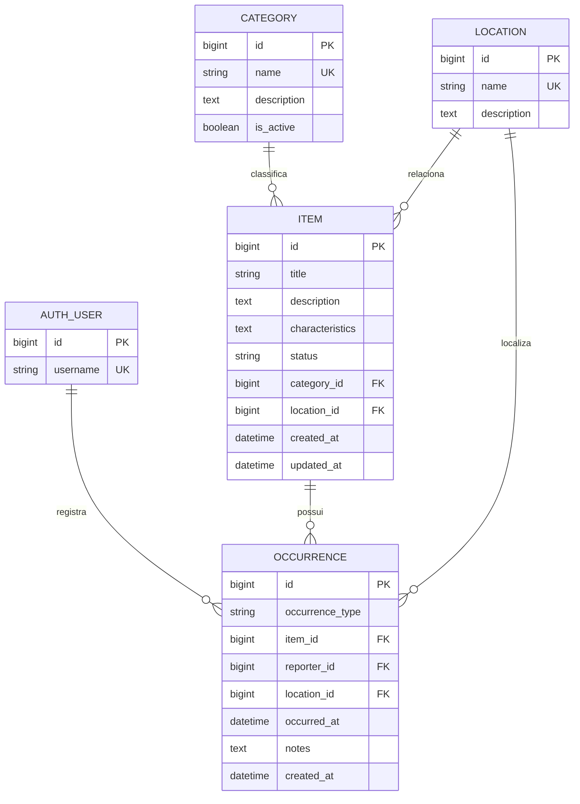

# Modelo relacional — Achados UFLA

## Regras principais

- Uma categoria classifica vários objetos; a categoria não pode ser excluída
  enquanto estiver sendo utilizada (`PROTECT`).
- Um local pode estar associado a vários objetos e ocorrências; também não pode
  ser excluído enquanto estiver sendo utilizado (`PROTECT`).
- Um objeto pode possuir várias ocorrências ao longo do seu ciclo de vida.
- Uma ocorrência pertence a um objeto e é registrada por um usuário.
- A data de uma ocorrência não pode estar no futuro.
- Um objeto devolvido deve possuir características registradas.
- O objeto é excluído junto com suas ocorrências relacionadas (`CASCADE`),
  pois a ocorrência não faz sentido sem o objeto.
